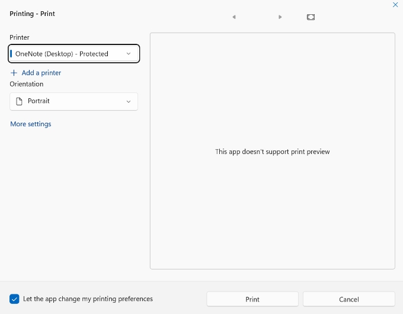

# How to Disable Print Preview in WinUI DataGrid?

This example describes how to disable print preview in [WinUI DataGrid](https://www.syncfusion.com/winui-controls/datagrid) (SfDataGrid).

### Disable print preview

You can disable the print preview in print dialog by setting `PrintTask.IsPreviewEnabled` property to false.

#### C#
```csharp
sfDataGrid.PrintTaskRequested += DataGrid_PrintTaskRequested;

private void DataGrid_PrintTaskRequested(object sender, DataGridPrintTaskRequestedEventArgs e)
{
    e.PrintTask = e.Request.CreatePrintTask("Printing", sourceRequested =>
    {
        sourceRequested.SetSource(e.PrintDocumentSource);
    });

    e.PrintTask.IsPreviewEnabled = false;
} 
```



Take a moment to peruse the [WinUI DataGrid - Printing](https://help.syncfusion.com/winui/datagrid/printing) documentation, where you can find about DataGrid printing with code examples.

### Requirements to run the demo
Visual Studio 2015 and above versions.